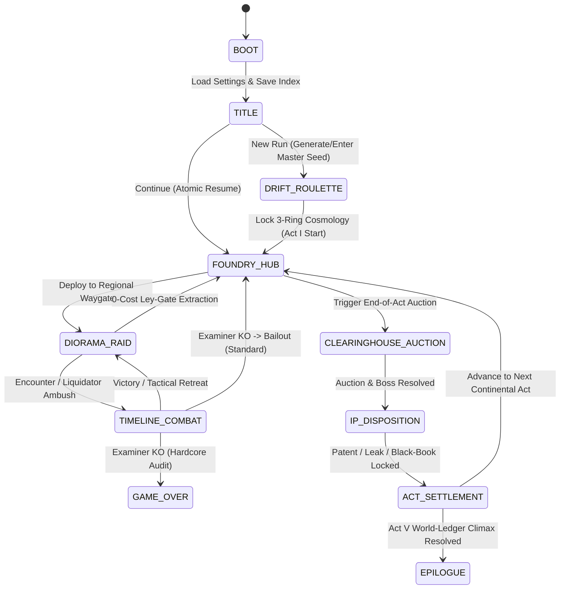

# 01 — Master Game Loop, Continental Acts & Mobile Session Flows

## 1. Master Game State Machine

Every playable session transitions deterministically through explicit top-level states managed by `RunStateBus`:

---

## 2. Five Continental Acts (Replacing the 1,080-Day Calendar)

The 1,080-day school calendar is eliminated. A full campaign spans **5 Episodic Acts** aboard the Examiner's **Mobile Ley-Rail Foundry**, engineered for zero filler days and 5–10 minute commuter beats.

| Act | Region / Nation | Core Systemic Focus | Act Climax |
| :--- | :--- | :--- | :--- |
| **Act I** | **The Brass Meridian** *(Free-Port Hub)* | Origin Loom onboarding, 4-node Spell Weaving unlocked in Episode 1, Brokerage hiring, first Patent/Leak choice | Turn-Based Clearinghouse Auction + **Audit Bailiff** |
| **Act II** | **The Ironclad Forges** *(Weaponized IP)* | Factory spell-leases, Armor-Pierce & Earth Pillar terrain warfare, 6-node Loom & Elemental Fusions | Forge Union Heist + **Ironclad Siege Sovereign** |
| **Act III** | **The Canopy Sanatoriums** *(Subscription Bio-Magic)* | Foreclosure Rot crisis, moral clash between profiting on cure scarcity vs. open-source Leaks, Water/Poison chains | Quarantine Raid + **Chief Actuary of Bio-Tariffs** |
| **Act IV** | **The Glass-Dune Freeholds & Basalt Vaults** *(Mirage & Keystone)* | 9-node Loom, Splitters, Feedback Loops, Mythic Elements, Black-Ledger Catalyst smuggling, Vault security | Dual Heist + **Sovereign Vault Guarantor** |
| **Act V** | **The World-Ledger Core** *(Harmonic Convergence)* | All 4 Nations react to your Patent/Leak ledger; bosses deploy counter-builds to your most-used **Patented** spells | **The Central Compiler** + 7 Shards of *Formula Zero* Finale |

---

## 3. The 3-Beat Mobile Session Loop (5–10 Minutes Per Beat)

Each Act consists of **4–5 Episodes**. Every Episode breaks into three self-contained mobile beats:

1. **Beat 1 — Market Pulse & Foundry Prep (2–4 min):**
   - Inspect the **Continental Ticker** (driven by the save's *Harmonic Drift* + prior Patent/Leak ripples).
   - Craft, overclock, or imprint 1 `SpellCircuit` in the **Aetheric Loom** and test-fire on the live 2.5D mannequin.
   - Assign benched Brokerage contractors to **Async Sub-Contracts** (resolved on Beat completion).
2. **Beat 2 — 2.5D Diorama Raid (5–8 min):**
   - Traverse compact, richly lit **3–5 screen 2.5D dioramas** (elevated brass catwalks, glowing ley-conduits, zero filler corridors).
   - Use custom spells as field tools (e.g., Earth Pillars bridge gaps, Wind clears miasma).
   - **0-Cost Ley-Gate Extraction** is available between rooms so players can bank loot and exit before stepping off a train.
3. **Beat 3 — Set-Piece Climax & IP Disposition (6–10 min):**
   - Resolve a **Turn-Based Clearinghouse Auction**, a **Black Ledger Registry Heist**, or an **Act Patent Boss**.
   - Make a binding **IP Disposition** decision on your flagship spell (*Patent*, *Open-Source Leak*, or *Black-Book*) that updates regional prices, Audit Heat, and enemy loadouts.

---

## 4. Mobile OS-Kill Auto-Save Contract

Android and iOS aggressively terminate backgrounded apps. **Manual-only saving is forbidden.**

- **Atomic Checkpoint Triggers:** Write `SaveRunState` atomically (temp file + rename + `.bak` rotation) immediately after:
  1. Every completed **turn** in `TIMELINE_COMBAT` (preserving exact Timeline Action Values, HP/MP, Stress, and active 2.5D constructs).
  2. Every **room transition**, chest/node interaction, or Ley-Gate extraction in `DIORAMA_RAID`.
  3. Every **spell commit/imprint** in the Aetheric Loom.
  4. Every **market trade**, **sub-contract dispatch**, or **auction round bid** in `FOUNDRY_HUB` / `CLEARINGHOUSE_AUCTION`.
- **Resume Invariant:** Relaunching after an OS kill drops the player directly back into the exact turn, room, or auction round with zero lost progress.

---

## 5. Difficulty & Audit Modes

| Mode | 0 HP Examiner Rule | Contractor Overkill / Trauma KO | Economy & Audit Heat |
| :--- | :--- | :--- | :--- |
| **Standard Audit** *(Default)* | Emergency Ley-Gate Extraction + **Syndicate Bailout Fee** (`15%` liquid Gold, floored at `0G`) | **Trauma** (1 Episode recovery or Clinic Fee); **Liquidation** is strictly **voluntary** (*Extract Relic Node*) | Standard prices & Heat decay |
| **Hardcore Audit** *(Ironman)* | **Margin Call (Run Over / Archive Seed)** | **Automatic Liquidation (Permadeath)** on Overkill (`≤ -50% MaxHP`) or KO while Traumatized | `+25%` Audit Heat gain; higher Royalty rewards |
