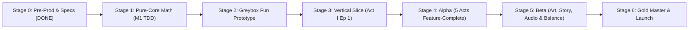

# Mana-Syndicate — Game Development Production Roadmap & Checklists

> **Golden Rule: Mechanics Before Paint.**  
> Never draw 100 sprites, write 5-act dialogue, or build 12 world mutators before a greybox 2.5D fight is fun with colored capsules. Prove the **core loop** first, polish **1 vertical slice** second, scale **content** third.

---

## What NOT to Build Too Early (Indie JRPG Trap Table)

| Temptation | Why It Kills Projects | When to Do It Instead |
| :--- | :--- | :--- |
| **Final 2.5D sprites & shaders** | Mechanics change during playtesting; redoing animated sheets wastes weeks. | **Stage 3** (1 slice) & **Stage 5** (full game). |
| **5-Act dialogue & lore scripts** | Story pacing depends on actual battle/raid length and UI box constraints. | **Stage 3** (Ep 1 only) & **Stage 5** (full 5 Acts). |
| **All 12 Global Laws & Mythic elements** | Multiplier bugs multiply exponentially across 12 laws before 1 fight works. | **Stage 4** (M2/M3 after M1 core is fun). |
| **Custom title screen & settings polish** | Players spend 99% of time in Loom + Combat; menus are easy to wrap later. | **Stage 3–5**. |

---

## Stage 0: Pre-Production & Systemic Lock *(Current — Done)*
**Goal:** Lock architecture, math formulas, mobile ergonomics, and zero-history Goldfish verification before writing `.gd` code.

- [x] **Workspace & Golden Standard:** `GOLDEN_STANDARD.md`, `AGENTS.md`, `.gitattributes` (Mac ↔ Windows LF), `scripts/verify-godot.sh`.
- [x] **Systemic Specs (`01`–`07`):** Core loop, Harmonic Drift RNG, Aetheric Loom, CTB Combat, Economy/Waygates, Mobile 2.5D Architecture, Balance Tables.
- [x] **Cold Goldfish Spec Audit:** All 30 P0/P1/P2 math, flow, and Godot 4 traps resolved (`docs/designs/systemic-baseline/goldfish_review.md`).
- [x] **39-Skill Kit:** Godot 4 + JRPG + Mobile UX + EGM + Anti-Slop skills vendored in `.agents/skills/`.
- [ ] **Local Toolchain Ready *(Optional before Stage 1)*:** Install `godot` (`brew install --cask godot`) and `gdtoolkit` (`uv tool install gdtoolkit`).

**Exit Gate:** Specs locked and pushed to `origin/main`. *(Passed)*

---

## Stage 1: Engine Boot & Pure-Core Simulation (`M1` Headless GUT TDD)
**Goal:** Prove 100% of math, RNG determinism, Loom stress, CTB Timeline, and JSON saves work **headlessly in milliseconds** with zero scenes.

- [ ] **Initialize `project.godot`:** `1280×720` (`canvas_items`, `expand`), `Compatibility (GLES3)`, `Engine.max_fps = 30`, `physics/common/physics_interpolation = true`, and install **GUT** into `addons/gut/`.
- [ ] **EGM Spec & Pure-Core Domain (`scripts/domain/`):** Implement `HarmonicDriftSeed` (`SHA-256` 6-stream RNG), `SpellCircuit` (M1 linear slots, dynamic Stress), `ContractorData` (4 stats + `loom_complexity_cap` + 3 axes), `TimelineBattleState` (CTB AV + `75 AV` Channel + Collision Break), and `SaveManager` (versioned JSON + atomic `.tmp`/`.bak` write).
- [ ] **M1 Headless GUT Suites (`tests/`):** Pass `test_harmonic_drift.gd`, `test_aetheric_loom.gd`, `test_timeline_combat.gd`, and `test_economy_waygates.gd`.
- [ ] **Subtree Contracts:** Add `Interfaces / Invariants / Side Effects` `README.md` in `scripts/domain/` and `scripts/systems/`.

**Exit Gate:** `./scripts/verify-godot.sh` passes **all 5 Gates** (`gdformat`, `gdlint`, `--import` + `check_scripts_compile.gd`, and headless GUT `quit(0)`).

---

## Stage 2: Greybox Core-Loop Prototype ("The Fun Kernel")
**Goal:** Playable 2.5D touch loop using **colored capsules, `ColorRect` panels, and placeholder text**. Zero final art or story.

- [ ] **Mobile Input & Safe-Area Shell:** Root HUD `MarginContainer` reading `DisplayServer.get_display_safe_area()`, `>= 80×80` virtual px tap targets, `1× / 2×` speed toggle.
- [ ] **Touch Aetheric Loom + Dry-Fire:** Snap M1 nodes (`Core -> Vessel -> Gate -> Loop`), inspect live Stress/Recoil, test on mannequin bay.
- [ ] **Greybox `BattleArena3D`:** `Camera3D` (`FOV 35°`, `-25°` pitch), `Vanguard`/`Vault` rows, top-center CTB Timeline strip, `2`-tap casting, `1`-Tap Tactical Signal, `0.38s` `LENS` pulse.
- [ ] **Minimal Loop:** Enter 1 greybox 3-room diorama -> fight 1–2 battles -> extract via 0-cost Ley-Gate -> save/kill app -> verify **atomic OS-kill resume** drops back into exact combat turn.

**Exit Gate (Fun Check):** Play 5 rounds on a phone/touchpad. Does weaving a circuit, reading enemy Channels on the Timeline, and landing a `Wind` Collision Break feel genuinely fun with grey boxes? *If not, tune `07-balance-tables-and-constants.md` now before making art.*

---

## Stage 3: Vertical Slice — Act I Episode 1 (*The Brass Meridian*)
**Goal:** One complete, shippable-quality **5–10 minute Beat** proving art, audio, UI, combat, IP choice, and mobile thermals work together.

- [ ] **1 Styled 2.5D Diorama:** `WorldEnvironment` sky/fog tint driven by `active_law_id`, 1 unshadowed `DirectionalLight3D`, `Sprite3D` (`ALPHA_CUT_DISCARD`, `TEXTURE_FILTER_NEAREST`), blob shadows.
- [ ] **Act I Ep 1 Cast & Boss:** Examiner + 1 Signature Agent + Brokerage recruits, 2–3 distinct enemies, and the **Audit Bailiff** mini-boss.
- [ ] **First IP Disposition Loop:** Craft flagship spell -> Patent or Open-Source Leak -> observe regional price ripple & enemy licensing.
- [ ] **Mobile Device Smoke Test:** Test on a real mid-range phone (`30 FPS` stable, zero thermal stutter, safe areas respected, `WorkerThreadPool` auto-save hitch-free, `NOTIFICATION_APPLICATION_PAUSED` flush verified).

**Exit Gate:** An external tester can pick up the phone, understand the Loom + Timeline without verbal coaching, and finish Act I Ep 1 cleanly.

---

## Stage 4: Production & Alpha (`M2` + `M3` Feature Complete)
**Goal:** All 5 Continental Acts playable from New Game to Act V Credits (placeholder art/dialogue allowed for Acts II–V).

- [ ] **M2 Systems:** Elemental Fusions (`6`), `The Exchange` Commodity Ticker, 5-Round **Turn-Based Clearinghouse Auctions**, Waygate Saturation (`0–100%`) + `Leyline Purge`, Async Sub-Contracts, `Bond` tiers + Loyalty Manual Override.
- [ ] **M3 Systems:** Mythic Elements (`5`), `Feedback Loop`, `TrojanKillSwitch` (1-time Auto-Break), all **12 Global Laws**, **Black Ledger** Registry Heists & Heat Laundering, Hardcore Audit (Ironman), Live Fracture-Mutation naming modal.
- [ ] **5 Continental Acts Blocked Out:** Brass Meridian, Ironclad Forges, Canopy Sanatoriums, Glass-Dune Freeholds & Basalt Vaults, World-Ledger Core (*Formula Zero* Finale).

**Exit Gate:** Full campaign completable start-to-finish in headless smoke + manual playtest with zero progression soft-locks.

---

## Stage 5: Beta (Content Complete, Art/Story/Audio & Balance)
**Goal:** Replace all remaining greybox assets, lock 5-Act narrative & Signature Agent arcs, and balance the economy/combat curves.

- [ ] **2.5D Art & Shader Pass:** Final sprite sheets, 12 sky/Ley-Spire shader palettes, Loom node VFX, `SubViewport` bandwidth audit.
- [ ] **Narrative & Dialogue:** 5-Act story scripts, 8–12 Signature Agent 3-Episode arcs, Corporate-Occult copywriting (`antislop-copywriting` check).
- [ ] **Audio & Game Feel:** Adaptive BGM/SFX buses (`godot-audio`), hit-stop, trauma shake, haptic taps (`game-feel`).
- [ ] **Economy & Combat Balance Audit:** Verify no Act I infinite Gold loops, boss HP/Break pacing across random `MasterSeed`s, and `Standard` vs `Hardcore` difficulty curves.

**Exit Gate:** Content complete; zero placeholder text/art; all automated GUT + lint checks green.

---

## Stage 6: Gold Master & Launch
**Goal:** Zero critical bugs, platform exports, and store-ready builds.

- [ ] **Zero P0/P1 Crash Policy:** Clean soak test on mid-range Android, iOS, and PC/Mac builds.
- [ ] **Export & Compliance (`godot-export`):** Configure `export_presets.cfg` (Android AAB, iOS, Desktop), verify offline-first save migration (`schema_version`), and hook optional Act I Demo -> Full Unlock boundary if desired.
- [ ] **Release Sign-Off:** Final `./scripts/verify-godot.sh --strict` + tag release in Git.

---

## Stage-to-Skill Activation Cheat Sheet

| Stage | Primary `.agents/skills/` to Load |
| :--- | :--- |
| **Stage 1 (Pure-Core TDD)** | `tdd`, `godot-gdscript`, `godot-gdscript-headless-testing`, `godot-resources`, `save-systems`, `rpg`, `roguelike` |
| **Stage 2 (Greybox Loop)** | `godot-25d-architecture`, `godot-3d-essentials`, `godot-nodes-scenes`, `godot-signals-groups`, `godot-ui-control`, `game-ui-ux`, `ai-behavior-trees-utility-ai` |
| **Stage 3 (Vertical Slice)** | `create-game-assets`, `godot-shaders`, `godot-animation`, `camera-systems`, `game-feel`, `performance-optimization` |
| **Stage 4–5 (Alpha & Beta)** | `dialogue-systems`, `shader-programming`, `godot-audio`, `antislop-ui`, `antislop-copywriting`, `code-review` |
| **Stage 6 (Launch)** | `godot-export`, `diagnosing-bugs`, `ponytail-review` |
